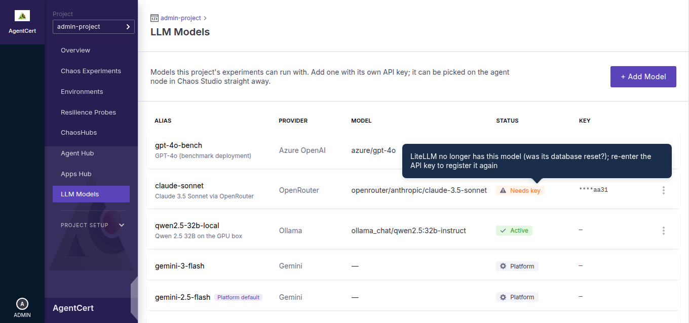
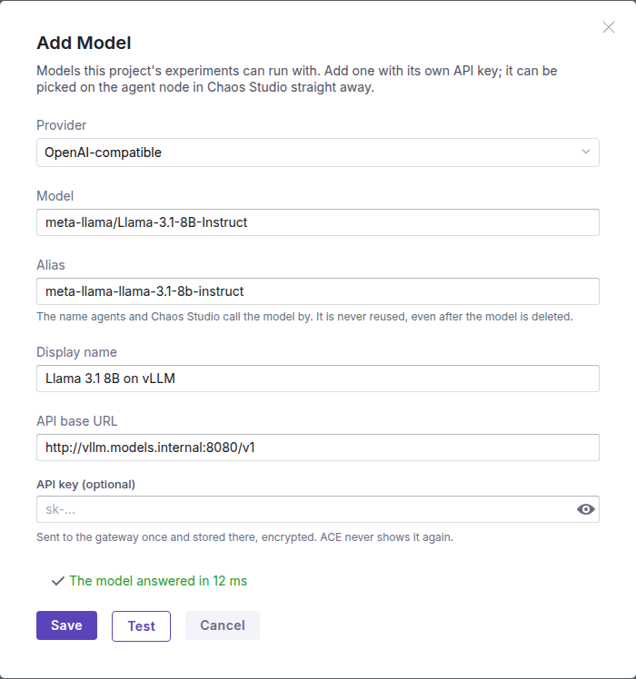
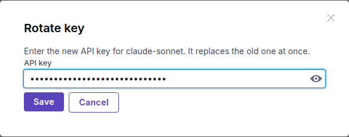

# Onboarding an LLM

> How to add an LLM to your project from the ACE UI, with your own API key, and run your
> experiments' agents on it, so you can benchmark the same experiment across models.

---

## 1. What you get

- An **LLM Models** page in the left-hand menu, right under **Apps Hub**.
- **Add Model**: pick a provider, enter the model and your API key, then **Save**. Save tests the model first.
  The model works straight away. Nothing is redeployed and no running experiment is
  interrupted.
- Every model you add appears in Chaos Studio, on the agent node's **LLM model** setting.
- **Test**, **Rotate key** and **Delete** for each model.

The page shows two kinds of models:

| Kind | Where it comes from | Who can use it |
|---|---|---|
| **Project models** | Added on this page | This project only |
| **Platform** models | Configured for everyone by whoever runs ACE | Every project; read-only here |

Models on this page are for **agents** only. Certification (grading a run and writing its
certificate) always uses the certifier's own model, which whoever runs ACE sets in `.env`. The
model you pick for an agent never changes how the agent is graded.

---

## 2. Before you start

- **You need the Owner role in the project** to add, test, rotate or delete a model. Executors
  and Viewers can see the list and pick models in Chaos Studio, but can't change it.
- **You need the model's details from your provider**: its name (for Azure, the
  *deployment* name), the endpoint URL where the provider needs one, and an API key.
- **The registry must be switched on** for your installation. If **Save** answers *"the model
  registry needs LiteLLM's database"*, ask whoever runs ACE to see
  [section 8](#8-for-the-platform-operator).

---

## 3. Add a model

1. Open **LLM Models** and click **+ Add Model**.
2. Choose the **Provider**. The form then asks only for the fields that provider needs.
3. Enter the **Model** (for Azure OpenAI the field is called **Deployment name**: the name you gave
   the deployment in Azure, which need not be the model's name). You don't need to type the
   provider prefix (`azure/`, `openai/`, …): ACE adds it for you.
4. Check the **Alias**. It is filled in from the model name, and you can change it. This is the
   name the model goes by in Chaos Studio, in agent logs and in certificates.
   - Use 2–63 lowercase letters, digits, `.`, `_` or `-`.
   - An alias is used once, ever. After a model is deleted its alias stays reserved, so an
     alias in an old certificate always means the same model. To change a model's settings,
     add a new one (for example `gpt-4o-bench-v2`).
5. Optionally give it a **Display name**, for example *GPT-4o (benchmark deployment)*.
6. Fill in the **API base URL**, **API version** and **API key** as the table below describes.
7. Optionally click **Test**. ACE sends the model one short prompt and shows how long it took to
   answer, or why it failed. Testing saves nothing.
8. Click **Save**. Save runs the same test first (unless you just ran it on these exact values)
   and saves the model only if it answers. The model is then listed as **Active** and is ready
   to use.
   - If the test fails, nothing is saved and the reason is shown. Fix the field it points to and
     click **Save** again.
   - If you know the model is fine (say the provider is briefly rate-limiting you), the button now
     reads **Save anyway**: it saves those same values without testing them again. Changing any
     field brings back the normal **Save**.

### What each provider needs

| Provider | Model (example) | API base URL | API version | API key |
|---|---|---|---|---|
| **Azure OpenAI** | your **deployment name** (Azure portal → your resource → Deployments), e.g. `gpt-4o` | **required**, e.g. `https://my-resource.openai.azure.com` | **required**, e.g. `2024-08-01-preview` | **required** |
| **OpenAI** | `gpt-4o-mini` | optional (defaults to `https://api.openai.com/v1`) | — | **required** |
| **Gemini** | `gemini-2.5-flash` | optional (defaults to Google's endpoint) | — | **required** |
| **OpenRouter** | `anthropic/claude-3.5-sonnet` | optional (defaults to `https://openrouter.ai/api/v1`) | — | **required** |
| **Ollama** | `qwen2.5:32b-instruct` | **required**, e.g. `http://ollama.ace.svc.cluster.local:11434` | — | optional |
| **OpenAI-compatible** (vLLM, LM Studio, …) | the name the server serves, e.g. `meta-llama/Llama-3.1-8B-Instruct` | **required**, e.g. `http://my-vllm:8000/v1` | — | optional |

The endpoint must be reachable from the gateway, not from your laptop
Your experiments' agents call models through ACE's LiteLLM gateway, which runs inside the
platform. A URL such as <code>http://localhost:11434</code> points at the gateway itself, not at
your machine. Use an address the platform can reach, such as a Kubernetes service name or a
public endpoint. <strong>Test</strong> runs from the gateway, so a passing test means your agents
can reach the model too.

### About your API key

- It is sent once to the gateway, which stores it encrypted. ACE never stores it and never
  shows it again; the list shows only its last four characters (`****1234`).
- Only experiments in **your** project can use it. Other projects don't see your models, and a
  run in another project that names your alias is refused.
- Give it a spending limit with your provider. A 30-run certification sends many requests.

---

## 4. Use the model in an experiment

1. In **Chaos Studio**, open your experiment and click the **agent** node.
2. In the drawer, open **Settings** and pick your model in the **LLM model** drop-down.
   **Platform default** keeps the model the platform uses by default.
3. Save the experiment and run it as usual.

A model you just added appears the next time you open the drawer. The model is chosen per
experiment, so to benchmark one agent across several models, make one copy of the experiment
per model, for example *pod-delete · gpt-4o* and *pod-delete · claude*. Run each, then compare
their certificates.

ACE checks the model **when you save** and **when a run starts**, before any chaos is injected.
A run is refused straight away if its model was deleted, belongs to another project, or is not
**Active**; it never fails halfway through.

> For API users: the `runChaosExperiment` mutation's optional `modelAlias` argument overrides
> the experiment's model for that run and the later runs of a multi-run batch.

---

## 5. Look after your models

Open a model's **⋮** menu for **Test**, **Rotate key** and **Delete**.

### What the statuses mean

| Status | Meaning | What to do |
|---|---|---|
| **Active** | The gateway serves the model. | Nothing. |
| **Registering** | ACE saved the model, but the gateway hasn't confirmed it yet. | Wait. The page refreshes itself, and ACE settles it within a few minutes. |
| **Deleting** | ACE asked the gateway to remove the model and is waiting for confirmation. | Wait, as above. |
| **Needs key** | The gateway no longer has the model, for example after its database was reset. Hover the badge to see why. | **Rotate key** and enter the key again. ACE kept every other setting. |
| **Platform** | Configured for every project in the platform's settings. | Nothing; it can't be edited here. |

While a model is not **Active**, Chaos Studio stops offering it and runs that use it are refused.

### Test

Sends the saved model one short prompt and reports whether it answered. Use it after a key
change on the provider's side, or if your agent's runs start failing.

### Rotate key

Replaces the model's API key. It takes effect on the next call, including for runs already in
progress. It is also how a **Needs key** model is brought back. For Ollama and OpenAI-compatible
servers that take no key, leave the field empty.

### Delete

Removes the model from the gateway. ACE refuses while the model is still in use, and names the
experiments using it:

- an experiment with a run in progress, or
- an enabled scheduled (cron) experiment.

Stop those runs, or switch the experiments to another model, then delete again. The alias stays
reserved after deletion (see [section 3](#3-add-a-model)).

---

## 6. Troubleshooting

| You see | Why | What to do |
|---|---|---|
| *the alias is already in use; aliases are never reused* | Another model has it now or had it before (in any project), or it names a platform model. | Choose another alias, e.g. add `-v2`. |
| *… needs an API key / an API version / an API base URL* | A field the provider requires is empty. | Fill it in (see the table in section 3). |
| *the API key may not reference a secret on the gateway* | The key looks like `os.environ/…` or `oidc/…`. The gateway would read its own secrets instead. | Paste the key itself. |
| *the API base must not contain credentials* | The URL has `user:password@` in it. | Put the key in the **API key** field instead. |
| *The API deployment for this resource does not exist* | Azure has no deployment by that name on this API base. A common cause is the browser autofilling your login name into the field. | Enter the deployment name exactly as Azure lists it under **Deployments**. |
| Test fails with an authentication error | The key is wrong, expired, or not valid for this model. | Check the key with your provider. |
| Test fails with a connection error | The gateway can't reach the endpoint. | Use an address reachable from inside the platform (see the note in section 3). |
| *no answer within 55s* | The model is slow, or still loading. Large local models can take a minute to load the first time. | Test again; it is often faster the second time. |
| *the gateway didn't confirm the change* | The gateway didn't answer in time. | Nothing: the model shows as **Registering** or **Deleting** until ACE settles it. |
| *the model is in use by …* | Delete was refused (see section 5). | Stop those runs or change those experiments. |
| *model not available in this project: "…" was deleted* (when saving or running) | The experiment still uses a deleted model. | Pick another model on the agent node. |
| *the model registry needs LiteLLM's database* | The registry isn't switched on for your installation. | Ask whoever runs ACE (section 8). |
| *ACE can't authenticate to LiteLLM* | The platform's gateway key is misconfigured. | Ask whoever runs ACE. |
| *permission_denied* | You aren't an Owner in this project. | Ask a project Owner. |

---

## 7. How it works, in brief

ACE keeps a record of each model (who owns it, its settings and its status) in its own
database. The API key goes only to the LiteLLM gateway, which serves the model to agents under
its alias and stores the key encrypted in its own database. The alias you pick is exactly the
model name your agent asks the gateway for, so traces and certificates show it unchanged.

For the full design, see `docs_2/MULTI_MODEL_CONFIGURATION_DESIGN.md`.

---

## 8. For the platform operator

The registry needs the LiteLLM gateway to have a database. `./scripts/setup.sh --deploy` (or
`--restart`) sets this up on every install, in two `.env` settings:

| Setting | Value |
|---|---|
| `LITELLM_DATABASE_URL` | A database named `litellm` on Langfuse's Postgres. LiteLLM creates the database itself on first start. |
| `LITELLM_SALT_KEY` | Generated once and never replaced. It encrypts every stored API key. |

The registry is on only when **both** are set, and then only after LiteLLM restarts. A Helm
deploy restarts it for you.

- **Back up `.env`.** If `LITELLM_SALT_KEY` is lost or changed, every stored key becomes
  unreadable and each model needs **Rotate key**.
- **Wiping Langfuse's Postgres volume also deletes the stored keys.** ACE marks those models
  **Needs key**, and owners restore them with **Rotate key**.
- **Never put `DATABASE_URL` in `.env`.** Langfuse reads that name too and would be pointed at
  LiteLLM's database.
- With `LITELLM_MODE=external`, setup leaves the registry off; an external gateway needs its own
  database. With `LANGFUSE_MODE=external` under docker compose there is no local Postgres, so
  clear `LITELLM_DATABASE_URL` there.
- The registry is not available with the flat `deploy/k8s/` manifests. Use the Helm chart or
  docker compose.
- Don't run the gateway with `--detailed_debug` or `LITELLM_LOG=DEBUG` except briefly while
  debugging: at debug level LiteLLM logs every model's API key in plain text, on every request.
- Each **Test**, and each **Save** that tests first, creates a trace in Langfuse, tagged
  `litellm-internal-health-check`, without the key and without any experiment or run ID, so it
  never ends up in a certificate.
- LiteLLM caps every test prompt at one token. Reasoning models (GPT-5, o-series) refuse that cap
  (*Unsupported parameter: 'max_tokens'*, or *max_tokens or model output limit was reached*), but
  only after accepting the endpoint, key and deployment, so ACE counts that refusal as a pass. If
  a LiteLLM upgrade changes those messages, `TestIntegrationReasoningModelPassesTheConnectionTest`
  in `pkg/model_config` fails.
